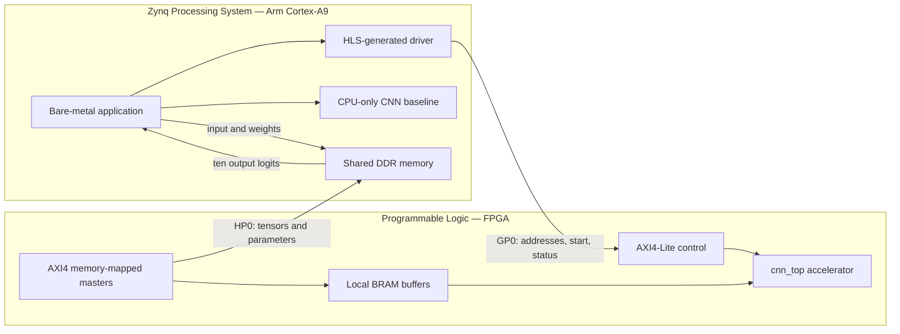

# Hardware-Accelerated CNN Inference on Xilinx Zynq SoC

## Resume-specific project context and interview guide

**Project period:** January 2026 – February 2026  
**Target platform:** ZedBoard, Xilinx Zynq-7000 XC7Z020  
**Project type:** FPGA/Arm hardware-software co-design for CNN inference  
**Original workload:** CIFAR-10 whole-image classification  
**Implementation tools:** PyTorch, Vitis HLS, Vivado, Vitis standalone/bare-metal software

> [!IMPORTANT]
> This document describes only the original project represented by the submitted resume bullets. It is separate from the later EdgeDet-Z20 redesign. The original system is a small CIFAR-10 **image classifier**, not a bounding-box object detector. It does not use BDD100K, FCOS, INT8/INT4 QAT, AXI4-Stream, AXI DMA, or NMS.

## Submitted resume entry

> **Hardware-Accelerated CNN Inference on Xilinx Zynq SoC (HW/SW Co-Design)**  
> Jan 2026 – Feb 2026
>
> - Architected a heterogeneous CNN inference system on Xilinx Zynq SoC, offloading convolution, activation, and pooling to FPGA fabric using Vitis HLS while managing control and data orchestration on the Arm processor.
> - Designed pipelined accelerator modules and integrated AXI-based interfaces to evaluate latency, throughput, and FPGA resource utilization against a CPU-only baseline.

## 1. Canonical project description

The project was a proof-of-concept CNN inference system for the ZedBoard's Zynq XC7Z020 SoC. It divided the application between the Arm Cortex-A9 processing system and a custom accelerator in the FPGA programmable logic.

The Arm processor handled initialization, DDR buffer management, parameter loading, fixed-point conversion, cache coherency, accelerator configuration, timing, completion detection, output interpretation, and the CPU-only comparison path. The FPGA accelerator executed the network's two convolution layers, fused ReLU activations, two max-pooling layers, and final fully connected layer.

The accelerator was written in synthesizable C++ and converted to RTL using Vitis HLS. The main transfer and compute loops were pipelined, while local arrays were used to keep weights and intermediate feature maps in FPGA BRAM. Vivado connected the accelerator to the Zynq processing system using AXI4-Lite for control and AXI4 memory-mapped master interfaces for shared DDR access.

The project demonstrates the architecture and evaluation methodology for Zynq CNN acceleration. The repository contains HLS synthesis estimates and generated bitstream/XSA artifacts, but it does not contain validated physical-board measurements. Consequently, synthesis latency and utilization may be discussed as estimates, while board FPS, Arm speedup, power, and temperature must not be presented as measured results.

### One-sentence explanation

> I designed a Zynq hardware-software co-design in which the Arm processor managed control, DDR data movement, cache coherency, timing, and result interpretation, while a fixed-point Vitis HLS accelerator in the FPGA executed the CNN forward pass.

## 2. Problem statement

CNN inference contains a large number of repeated multiply-accumulate operations. A general-purpose processor executes these operations as software instructions, whereas an FPGA can implement application-specific arithmetic pipelines and memories.

The project investigated the following engineering question:

> How can a compact CNN be partitioned between the Arm processing system and FPGA programmable logic of a Zynq SoC, and how can the resulting accelerator be evaluated in terms of cycle latency, throughput, and FPGA resource cost?

The goal was not to develop a state-of-the-art vision model. The goal was to understand and implement the complete acceleration path:

1. Define a CNN whose dimensions match in PyTorch, C++, HLS, and Arm software.
2. Choose a resource-efficient numeric representation.
3. Implement synthesizable CNN operators.
4. Apply HLS loop pipelining and on-chip buffering.
5. expose accelerator control and DDR pointers over AXI.
6. Integrate the accelerator with the Zynq processing system in Vivado.
7. Control the accelerator from a bare-metal Arm application.
8. Compare the hardware path with a straightforward CPU-only implementation.

## 3. Why Zynq and why hardware-software co-design

A Zynq-7000 device combines two different computing regions.

### Processing System (PS)

The PS contains:

- Dual Arm Cortex-A9 processors.
- DDR controller.
- Caches and timers.
- Ethernet, UART, SD, USB, and other peripherals.
- AXI ports for communication with programmable logic.

It is suitable for control-oriented and irregular work such as:

- Program initialization.
- Driver execution.
- Memory and address management.
- Preprocessing and postprocessing.
- Cache maintenance.
- Communication and error handling.
- Performance measurement.

### Programmable Logic (PL)

The PL contains:

- LUTs and flip-flops.
- DSP slices.
- BRAMs.
- Configurable routing.
- Custom state machines and datapaths.

It is suitable for:

- Repeated multiply-accumulate operations.
- Deterministic pipelines.
- Custom fixed-point arithmetic.
- Parallel or partially parallel execution.
- On-chip data reuse.

### Meaning of heterogeneous architecture

The system is called heterogeneous because two different compute architectures cooperate:

- The Arm runs general-purpose software.
- The FPGA implements a specialized CNN datapath.

Hardware-software co-design means the algorithm, numeric format, memory layout, accelerator interface, Vivado system, and Arm driver are designed together. A correct convolution module alone is insufficient; all components must agree on tensor shapes, parameter order, DDR addresses, control sequencing, and cache behaviour.

## 4. System architecture



The design has two logically separate communication paths.

### Control path

```text
Arm software
    → Zynq M_AXI_GP0
    → control AXI interconnect
    → accelerator s_axi_control
```

This path is used to:

- Write input, weight, bias, and output DDR addresses.
- Set the accelerator start bit.
- Read idle, ready, and done status.
- Access interrupt-related control registers.

### Data path

```text
Accelerator m_axi_gmem0..3
    → data AXI interconnect
    → Zynq S_AXI_HP0
    → PS DDR controller
    → shared DDR
```

The accelerator is the AXI master on the data path. It initiates DDR reads and writes after the Arm supplies the addresses and starts it.

## 5. CNN architecture

The original network is a compact CIFAR-10 classifier:

```text
Input 3×32×32
  → Conv1 3×3, 3→16, stride 1, valid
  → ReLU
  → MaxPool 2×2
  → Conv2 3×3, 16→32, stride 1, valid
  → ReLU
  → MaxPool 2×2
  → Flatten 32×6×6 = 1152
  → Fully connected 1152→10
  → Ten class logits
  → Argmax
```

| Stage | Input shape | Output shape | Parameters | MACs |
|---|---:|---:|---:|---:|
| Input | — | 3×32×32 | 0 | 0 |
| Conv1 + ReLU | 3×32×32 | 16×30×30 | 432 weights + 16 biases | 388,800 |
| MaxPool1 | 16×30×30 | 16×15×15 | 0 | 0 |
| Conv2 + ReLU | 16×15×15 | 32×13×13 | 4,608 weights + 32 biases | 778,752 |
| MaxPool2 | 32×13×13 | 32×6×6 | 0 | 0 |
| Fully connected | 1,152 | 10 | 11,520 weights + 10 biases | 11,520 |

Total parameter count:

```text
(432 + 16) + (4,608 + 32) + (11,520 + 10)
= 16,618 parameters
```

Total principal MAC count:

```text
388,800 + 778,752 + 11,520
= 1,179,072 MACs per inference
```

### Convolution equation

For an output channel `oc` and output location `(oh, ow)`:

```text
sum = bias[oc]

for every input channel ic
  for every kernel row kh
    for every kernel column kw
      sum += input[ic][oh+kh][ow+kw]
             × weight[oc][ic][kh][kw]

output[oc][oh][ow] = max(sum, 0)
```

Mathematically:

\[
y_{oc,oh,ow}=b_{oc}+\sum_{ic}\sum_{kh}\sum_{kw}
x_{ic,oh+kh,ow+kw}w_{oc,ic,kh,kw}
\]

The output is then passed through ReLU:

\[
y=\max(0,y)
\]

### Output dimensions

For a valid convolution with stride one:

\[
H_{out}=H_{in}-K+1
\]

Therefore:

- `32 - 3 + 1 = 30` for Conv1.
- `15 - 3 + 1 = 13` for Conv2.

The second max-pool receives a 13×13 feature map. Integer division produces 6×6, so only the first 12 rows and columns are pooled; the final row and column are not used.

### Why softmax is absent

The accelerator returns logits. The Arm selects the largest logit using argmax. Softmax is not required for class selection because it preserves ordering:

```text
argmax(logits) = argmax(softmax(logits))
```

Omitting softmax avoids exponentiation, division, and additional hardware.

## 6. Hardware/software partition

### Work performed on the Arm

- Initialize the HLS-generated accelerator driver.
- Convert stored float parameters to the accelerator's fixed-point representation.
- Copy input, weights, and biases into known DDR buffers.
- Flush cached CPU writes before PL access.
- Program DDR pointer registers over AXI4-Lite.
- Start the accelerator.
- Wait for completion.
- Stop the timer.
- Invalidate cached output before CPU access.
- Read ten output logits.
- Perform argmax.
- Run the CPU-only comparison implementation.
- Calculate average latency, FPS, and speedup.

### Work performed in the FPGA

- Read the input and parameters from DDR.
- Copy them into local buffers.
- Execute Conv1 and fused ReLU.
- Execute MaxPool1.
- Execute Conv2 and fused ReLU.
- Execute MaxPool2.
- Flatten the final feature tensor logically.
- Execute the fully connected layer.
- Write ten logits back to DDR.
- Assert completion status.

### Why all CNN layers were kept in PL

Returning intermediate feature maps to the Arm after each layer would add DDR traffic and software synchronization. Keeping the complete forward path in the accelerator allows intermediate feature maps to remain in local FPGA memories.

The resume bullet mentions convolution, activation, and pooling, but the implementation also offloads the fully connected layer. The bullet is therefore conservative rather than exaggerated.

## 7. Fixed-point design

Inputs, weights, activations, and final logits use:

```cpp
ap_fixed<16, 6>
```

This representation has:

- 16 total bits.
- 6 integer bits including the sign.
- 10 fractional bits.
- Approximate range from −32 to just below +32.
- Resolution of `2^-10 = 0.0009765625`.

Accumulation uses:

```cpp
ap_fixed<32, 16>
```

This representation has a much wider range and is used because a CNN output can sum many products:

- 27 products for a Conv1 output.
- 144 products for a Conv2 output.
- 1,152 products for one FC output.

### Float-to-fixed conversion

The Arm conversion is conceptually:

```c
fixed_value = (int16_t)(float_value * 1024);
```

because `2^10 = 1024`.

The reverse conversion is:

```c
float_value = fixed_value / 1024.0f;
```

### Why fixed point was chosen

- Smaller arithmetic than float32.
- Lower FPGA resource cost.
- Simpler datapaths.
- More deterministic latency.
- Better fit for the XC7Z020.
- Allows wider parallelism for a given resource budget.

### Quantization limitation

The proof of concept does not implement calibrated per-layer quantization, explicit round-to-nearest, or explicit saturation. The default fixed-point narrowing behaviour and simple conversion macros are used.

A production improvement would include:

- Calibration using representative data.
- Layer-specific activation scales.
- Per-output-channel weight scales.
- Explicit rounding.
- Explicit saturation.
- Overflow tests.
- Bit-exact comparison across Python, C, HLS, and RTL.

## 8. HLS accelerator implementation

The top-level `cnn_top` function exposes arrays for:

- Input image.
- Conv1 weights and biases.
- Conv2 weights and biases.
- FC weights and biases.
- Output logits.

### AXI memory bundles

| Bundle | Data |
|---|---|
| `gmem0` | Input image and output logits |
| `gmem1` | Conv1 weights and biases |
| `gmem2` | Conv2 weights and biases |
| `gmem3` | FC weights and biases |

The four accelerator master interfaces enter an AXI interconnect configured with four slave-side inputs and one master-side output connected to PS HP0. The interconnect arbitrates their access to shared DDR.

### AXI4-Lite interface

HLS exposes pointer arguments and the block control protocol through `s_axi_control`. The generated driver provides functions such as:

```c
XCnn_top_Set_input_r(...);
XCnn_top_Set_conv1_weights(...);
XCnn_top_Set_conv1_bias(...);
XCnn_top_Set_conv2_weights(...);
XCnn_top_Set_conv2_bias(...);
XCnn_top_Set_fc_weights(...);
XCnn_top_Set_fc_bias(...);
XCnn_top_Set_output_r(...);
XCnn_top_Start(...);
XCnn_top_IsDone(...);
```

### Local memories

The accelerator declares local arrays for:

- Input tensor.
- Conv1 output.
- Pool1 output.
- Conv2 output.
- Pool2 output.
- FC output.
- All weights and biases.

Most large arrays are inferred as BRAM. This enables data reuse within the PL and avoids storing intermediate feature maps in DDR.

### Approximate external payload

Ignoring AXI overhead:

- Input: `3,072 × 2 = 6,144 bytes`.
- Parameters: `16,618 × 2 = 33,236 bytes`.
- Output: `10 × 2 = 20 bytes`.
- Total useful payload: approximately 39.4 KB per invocation.

Weights are loaded into local memory on every invocation. Keeping immutable weights permanently resident would reduce repeated transfer overhead in a later design.

## 9. Pipelining strategy

The accelerator applies `#pragma HLS PIPELINE II=1` to:

- Input loading.
- Convolution weight loading.
- Bias loading.
- Fully connected weight loading.
- Innermost convolution MAC loops.
- Max-pooling output loops.
- Fully connected inner loop.
- Output storage.

### Meaning of II=1

Initiation interval is the cycle spacing between the starts of successive loop iterations. An II of one means the pipeline can accept one new iteration every cycle after filling.

It does not mean:

- The whole convolution finishes in one cycle.
- A complete frame finishes every cycle.
- All network layers overlap.
- The top-level accelerator can accept another image immediately.

### Loop-level versus network-level pipelining

This implementation is loop-pipelined but layer-sequential:

```text
load → Conv1 → Pool1 → Conv2 → Pool2 → FC → store
```

The HLS report identifies the full top-level transaction as non-pipelined. A fully streaming design would instead use line buffers, FIFOs, `hls::stream`, and `DATAFLOW` so that multiple layers could process different portions of an image concurrently.

### Why aggressive unrolling was avoided

Unrolling duplicates arithmetic and requires matching memory bandwidth. It can increase:

- DSP use.
- LUT and FF use.
- BRAM banking.
- Array partitioning.
- Routing congestion.

The selected implementation prioritized resource efficiency and reliable fit on the XC7Z020. Arithmetic units are reused across many loop iterations.

The core design tradeoff was:

```text
less unrolling → fewer resources, more cycles
more unrolling → more throughput, more resources
```

## 10. Vivado integration

The Vivado block design contains:

- Zynq Processing System 7.
- Packaged `cnn_top` HLS IP.
- AXI interconnect for GP0 control.
- AXI interconnect for HP0 DDR traffic.
- Processor System Reset.
- External DDR and fixed I/O.
- 100 MHz PL clock from `FCLK_CLK0`.
- Fabric interrupt connection.

### Control connection

```text
PS M_AXI_GP0
    → axi_gp_ic/S00_AXI
    → axi_gp_ic/M00_AXI
    → cnn_accel/s_axi_control
```

### Data connection

```text
cnn_accel/m_axi_gmem0..3
    → axi_hp_ic/S00_AXI..S03_AXI
    → axi_hp_ic/M00_AXI
    → PS S_AXI_HP0
```

### Clock and reset

The PS generates a 100 MHz `FCLK_CLK0` for:

- Accelerator clock.
- GP0 interconnect clock.
- HP0 interconnect clock.
- PS AXI interface clocks.
- Reset synchronization logic.

### Interrupt nuance

The accelerator interrupt signal is connected to `IRQ_F2P`, so the hardware design supports interrupts. The Arm benchmark currently waits by polling `XCnn_top_IsDone()`. Therefore, it is accurate to say that an interrupt path exists, but inaccurate to say the original runtime used interrupt-driven completion.

## 11. Arm orchestration sequence

### 11.1 Initialize the accelerator

The application locates and initializes the generated device driver:

```c
XCnn_top_Config *cfg = XCnn_top_LookupConfig(...);
XCnn_top_CfgInitialize(&cnn_instance, cfg);
```

### 11.2 Populate DDR

Fixed DDR offsets are used for:

- Input.
- Conv1 weights and biases.
- Conv2 weights and biases.
- FC weights and biases.
- Output logits.

The application converts float parameter arrays into Q6.10 `int16_t` values and copies them to these locations.

### 11.3 Maintain cache coherency

The HP0 path is not automatically coherent with the Cortex-A9 data cache in this design.

Before hardware reads data written by the CPU:

```c
Xil_DCacheFlushRange(...);
```

After hardware writes data that the CPU will read:

```c
Xil_DCacheInvalidateRange(...);
```

Without these operations, the accelerator or processor could observe stale data.

### 11.4 Configure and start the accelerator

The Arm writes every DDR pointer to the generated control registers, starts the timer, asserts start, and polls until completion.

### 11.5 Read and interpret the result

The output consists of ten fixed-point logits. The Arm scans them and selects the maximum as the predicted class.

## 12. CPU-only baseline

The bare-metal application contains a direct C implementation of:

- Input conversion.
- Conv1 and ReLU.
- MaxPool1.
- Conv2 and ReLU.
- MaxPool2.
- FC.
- Argmax.

The CPU code uses the same dimensions and parameter ordering as the accelerator, but performs arithmetic using `float` arrays and scalar nested loops.

Both CPU and FPGA paths are repeated 100 times. The timing harness computes:

\[
\text{Average latency} = \frac{\text{total elapsed time}}{\text{run count}}
\]

\[
\text{FPS} = \frac{1000}{\text{latency in milliseconds}}
\]

\[
\text{Speedup} = \frac{\text{CPU latency}}{\text{FPGA latency}}
\]

### Benchmark limitations

The CPU baseline is useful for architectural comparison but is not the fastest achievable Cortex-A9 implementation. It is not:

- NEON-vectorized.
- Multithreaded.
- Cache-tiled.
- Quantized to the same numeric format as the FPGA.
- Based on an optimized inference library.

A rigorous comparison would add warm-up runs, use matching input and numeric formats, define whether preprocessing and transfers are inside the timing boundary, report distributions rather than only a mean, and compare against an optimized Arm implementation.

## 13. HLS synthesis results

The checked-in HLS synthesis report targets:

- Part: `xc7z020-clg484-1`.
- Clock target: 10 ns.
- Nominal PL frequency: 100 MHz.
- HLS estimated clock delay: 7.535 ns.

### Latency estimate

```text
Latency: 1,195,472 cycles
Absolute latency at 100 MHz: 11.955 ms
Invocation interval: 1,195,473 cycles
Top-level pipeline type: no
```

The theoretical accelerator invocation rate corresponding to this estimate is:

\[
\frac{1000}{11.955}\approx83.6\text{ inferences/second}
\]

This is a synthesis estimate, not measured camera FPS or measured board throughput.

### Latency breakdown

| Stage | Estimated cycles | Estimated time at 100 MHz |
|---|---:|---:|
| Input load | 3,075 | 0.03075 ms |
| Conv1 weight load | 436 | 0.00436 ms |
| Conv2 weight load | 4,613 | 0.04613 ms |
| FC weight load | 11,523 | 0.11523 ms |
| Conv1 | 388,810 | 3.88810 ms |
| Pool1 | 3,605 | 0.03605 ms |
| Conv2 | 778,763 | 7.78763 ms |
| Pool2 | 1,157 | 0.01157 ms |
| FC | 11,529 | 0.11529 ms |
| Output store | 13 | 0.00013 ms |

Conv2 is the primary performance bottleneck because it contains 778,752 MACs.

### Resource estimate

| Resource | Estimated use | Available | Estimated utilization |
|---|---:|---:|---:|
| BRAM18K | 67 | 280 | 23% |
| DSP | 6 | 220 | 2% |
| Flip-flops | 8,699 | 106,400 | 8% |
| LUTs | 12,202 | 53,200 | 22% |
| URAM | 0 | 0 | 0% |

These are HLS synthesis estimates, not measured resources and not a replacement for post-route utilization and timing reports.

### Interpretation

The design is resource-conservative:

- DSP usage is low because compute loops are not heavily unrolled.
- BRAM is used to store parameters and intermediate tensors.
- LUT and FF estimates leave substantial headroom.
- Latency is dominated by sequential convolution MACs rather than DDR payload.
- The design has space for future parallelism if memory banking and routing permit it.

## 14. Training and parameter export

The PyTorch training definition matches the HLS architecture exactly:

- Conv1: 3→16, 3×3, valid.
- ReLU.
- 2×2 max-pooling.
- Conv2: 16→32, 3×3, valid.
- ReLU.
- 2×2 max-pooling.
- FC: 1,152→10.

The training flow includes:

- CIFAR-10 download.
- Random horizontal flip.
- Random crop with padding.
- CIFAR-10 mean and standard-deviation normalization.
- Cross-entropy loss.
- Adam optimizer.
- Step learning-rate scheduling.
- Best-checkpoint saving.
- Export of weights and biases into C include files.

### Tensor layout contract

All components must agree on:

- Input order: channel, row, column (`CHW`).
- Conv weights: output channel, input channel, kernel row, kernel column (`OIHW`).
- FC weights: class, flattened input index.
- Flatten order: channel, row, column.
- Fixed-point fractional bits: 10.

A tensor layout mismatch can produce incorrect predictions even when the accelerator runs and asserts done successfully.

### Weight-status limitation

The checked-in Arm weight header identifies its contents as placeholder weights. The repository does not provide a defensible recorded final CIFAR-10 accuracy. Do not claim a trained accuracy unless it is supported by an external checkpoint and evaluation log.

## 15. Verification status

The HLS C-simulation testbench uses:

- A deterministic gradient input.
- Random small weights generated using a fixed seed.
- Fixed-point accelerator execution.
- A check that outputs are not all zero.
- Checks for NaN and unreasonable values.

This is sufficient for a basic execution sanity test, but it is not a complete bit-exact golden-model comparison. Although a software helper is present, the checked-in testbench does not perform a full layer-by-layer numerical comparison.

The defensible statement is:

> I created a deterministic HLS C-simulation testbench and performed output sanity checking, then used HLS synthesis reports to evaluate cycle latency and resource estimates.

Do not claim:

> I proved bit-exact agreement across PyTorch, C, HLS C simulation, and RTL co-simulation.

## 16. Complete inference sequence

1. Boot the standalone Arm application.
2. Initialize the HLS-generated accelerator driver.
3. Convert parameters from float to Q6.10.
4. Store parameters in fixed DDR buffers.
5. Flush parameter cache lines.
6. Prepare a 3×32×32 input tensor in CHW order.
7. Store the input in DDR.
8. Write input, parameter, bias, and output pointers through AXI4-Lite.
9. Flush the input cache range.
10. Read the start time.
11. Assert accelerator start.
12. Accelerator reads input and parameters through HP0.
13. Accelerator loads local BRAM buffers.
14. Accelerator executes Conv1 and fused ReLU.
15. Accelerator executes MaxPool1.
16. Accelerator executes Conv2 and fused ReLU.
17. Accelerator executes MaxPool2.
18. Accelerator executes the FC layer.
19. Accelerator writes ten logits to DDR.
20. Accelerator asserts done.
21. Arm observes completion by polling.
22. Arm reads the stop time.
23. Arm invalidates the output cache range.
24. Arm performs argmax.
25. Arm repeats the operation for average timing.
26. Arm runs the software CNN baseline.
27. Arm calculates latency, FPS, and CPU/FPGA speedup.

## 17. Explanation of every resume phrase

### “Architected a heterogeneous CNN inference system”

The application was divided between a general-purpose Arm processor and a custom FPGA accelerator. The two compute domains cooperated through shared DDR and AXI interfaces.

### “Offloading convolution, activation, and pooling”

The repetitive CNN arithmetic was moved from Arm software into synthesizable C++ modules in the PL. The accelerator also contained the FC layer.

### “Using Vitis HLS”

Vitis HLS translated C++ operator implementations into RTL, interpreted interface pragmas, scheduled pipelined loops, inferred memories and arithmetic, and generated an IP block with drivers and reports.

### “Managing control and data orchestration on the Arm processor”

The Arm owned DDR preparation, pointer programming, cache maintenance, accelerator start and completion, timing, argmax, and CPU comparison.

### “Designed pipelined accelerator modules”

The main data-loading and compute loops used HLS pipeline directives with an intended II of one. This describes loop-level pipelining, not a fully streaming pipeline across all layers.

### “Integrated AXI-based interfaces”

AXI4-Lite through GP0 carried control and pointer registers. AXI4 memory-mapped master interfaces through HP0 carried input, parameters, and output between the accelerator and DDR.

### “Evaluate latency, throughput, and FPGA resource utilization”

The HLS report provided cycle latency, absolute latency at the target clock, invocation interval, clock estimate, and BRAM/DSP/FF/LUT estimates.

### “Against a CPU-only baseline”

The Arm code contains the same CNN as scalar floating-point nested loops, a timing harness, repeated runs, FPS calculation, and CPU-latency-to-FPGA-latency speedup calculation.

## 18. Interview answers

### Explain the project in two minutes

> I implemented a proof-of-concept CNN inference system on the ZedBoard's Zynq XC7Z020. The purpose was to explore hardware-software partitioning rather than build a state-of-the-art model. The workload was a compact CIFAR-10 classifier with two convolution-ReLU-pooling stages followed by a fully connected layer.
>
> I mapped the complete CNN forward pass into synthesizable C++ using Vitis HLS. Activations and weights used 16-bit Q6.10 fixed point, while accumulation used a wider 32-bit Q16.16 type. I placed input, parameters, and intermediate tensors in local arrays so HLS could infer BRAM, and applied II=1 pipelining to the main loading, convolution, pooling, dense, and output loops. I deliberately avoided aggressive unrolling to keep DSP and logic usage low on the XC7Z020.
>
> The Arm application loaded parameters and input into shared DDR, flushed the cache, programmed the accelerator's DDR pointer registers through AXI4-Lite over GP0, and started the accelerator. The accelerator acted as an AXI memory master and accessed DDR through HP0. After completion, the Arm invalidated the output cache, performed argmax, and recorded timing. I also implemented the same CNN as scalar C loops on the Arm to create a CPU-only comparison path.
>
> HLS estimated 1,195,472 cycles, or 11.955 milliseconds at 100 MHz. It estimated 67 BRAM18Ks, six DSPs, 8,699 flip-flops, and 12,202 LUTs. Those are synthesis estimates; I do not present them as physical-board FPS or measured speedup.

### Why use Zynq instead of only an FPGA?

> A complete application requires more than arithmetic. The Arm is better suited to drivers, memory management, communication, timing, and control, while the FPGA is better suited to regular multiply-accumulate pipelines. Zynq provides both in one device with shared DDR and AXI communication.

### Why was convolution accelerated?

> Convolution contains most of the network's arithmetic and has regular nested loops with predictable memory access. In this network, the two convolution layers account for 1,167,552 of the 1,179,072 main MACs, making them the most valuable acceleration target.

### What exactly did the Arm do?

> It initialized the accelerator, converted and copied parameters, prepared DDR buffers, handled cache coherency, wrote pointer registers, started the accelerator, waited for done, read outputs, performed argmax, measured time, and ran the CPU-only baseline.

### What exactly did the FPGA do?

> It read input and parameters from DDR, cached them in local buffers, executed both convolution-ReLU stages, both max-pooling stages, and the fully connected layer, and wrote ten class logits back to DDR.

### What is an initiation interval?

> Initiation interval is the number of cycles between starting consecutive iterations of a pipelined loop. II=1 means the loop can accept one new iteration per cycle after pipeline fill. It does not mean the complete loop or network finishes in one cycle.

### Was the whole network fully pipelined?

> No. The internal loops were pipelined, but the layers executed sequentially. A full network dataflow pipeline would require streams, FIFOs, line buffers, and dataflow scheduling so multiple layers could overlap.

### Why only six DSPs?

> I intentionally reused arithmetic units instead of aggressively unrolling channel and kernel loops. This kept resource use low but increased latency. It was a resource-oriented design point with room for later parallelism.

### Why 67 BRAMs?

> The design holds the input, weights, biases, and multiple intermediate feature maps in local arrays. HLS maps these arrays into BRAM. This reduces repeated DDR traffic but increases on-chip memory usage.

### Why Q6.10?

> It provided ten fractional bits of precision while retaining a useful signed range in 16 bits. This was substantially cheaper than float32 for FPGA implementation. A wider Q16.16 accumulator was used to reduce overflow risk during long dot products.

### How was cache coherency handled?

> The HP0 path was non-coherent with the Arm cache. I flushed CPU-produced input and parameters before accelerator access and invalidated accelerator-produced output before CPU access.

### What is the difference between GP0 and HP0?

> GP0 was the low-bandwidth control path from the Arm to accelerator registers. HP0 was the high-performance data path that allowed the accelerator to access shared DDR.

### Did the project use DMA?

> The original version did not use AXI DMA. The HLS core had memory-mapped AXI master ports and directly initiated DDR accesses through HP0.

### Did it use AXI4-Stream?

> No. The original data path was AXI4 memory mapped. AXI4-Stream and DMA are part of the later EdgeDet redesign.

### Did it use interrupts?

> The Vivado design connected the accelerator interrupt to the processing system, but the benchmark application polled the done register. Interrupt-driven completion was a planned runtime improvement.

### Why no softmax?

> Argmax over logits gives the same predicted class as argmax after softmax. Skipping softmax avoids unnecessary exponentiation and division.

### What was the largest bottleneck?

> Conv2. It performs 778,752 MACs and accounts for approximately 7.788 milliseconds of the 11.955-millisecond HLS latency estimate.

### How would you optimize Conv2?

> I would select a controlled input-channel or output-channel unroll factor, partition or bank the associated weight and activation arrays, and verify that the additional DSP and BRAM port demand still meets timing and resource limits. For a larger redesign, I would use line buffers and streaming dataflow.

### How was the CPU baseline implemented?

> It used scalar floating-point C loops on the Cortex-A9 with the same network shapes and weights. Both paths were repeatedly timed, and the program calculated average latency, FPS, and CPU-to-FPGA speedup.

### Was that a perfectly fair comparison?

> It was a useful straightforward baseline, but not a comparison against the best possible Arm implementation. The CPU path was not NEON optimized or quantized to the same format. A stricter study would add an optimized matching Arm baseline and precisely define the timing boundary.

### What results can be safely quoted?

> HLS estimated 1,195,472 cycles or 11.955 milliseconds at 100 MHz. Estimated resources were 67 BRAM18Ks, six DSPs, 8,699 flip-flops, and 12,202 LUTs. I do not quote a measured board FPS, Arm speedup, power, or temperature.

### Was it real time?

> The synthesis latency corresponds to a theoretical accelerator invocation rate of about 83.6 inferences per second. That is not the same as measured end-to-end video FPS because it excludes physical-board effects, capture, preprocessing, communication, and display.

### How was the accelerator verified?

> The checked-in C-simulation testbench uses deterministic input and random parameters with a fixed seed, then checks that outputs are finite and nonzero. It is a sanity test rather than complete bit-exact verification.

### What was the hardest engineering issue?

> Maintaining one consistent contract across PyTorch, exported parameter arrays, Arm buffers, HLS arrays, and AXI registers. Tensor ordering, fixed-point scaling, address alignment, cache maintenance, and start/done sequencing all had to agree.

### What would you change in a production version?

> I would add calibrated quantization and explicit saturation, bit-exact reference testing, RTL co-simulation, controlled channel parallelism, streaming line buffers, dataflow between layers, persistent weights, double buffering, interrupt-driven completion, a robust runtime protocol, and an optimized matching Arm baseline. I would then collect post-route and physical-board measurements.

## 19. Short presentations

### Ten-second version

> I partitioned a compact CNN across the Zynq Arm and FPGA: the Arm handled control and DDR orchestration, while a fixed-point Vitis HLS accelerator performed the CNN layers through AXI interfaces and was evaluated against an Arm software baseline.

### Thirty-second version

> I implemented a compact CIFAR-10 CNN accelerator for the Zynq XC7Z020. The Cortex-A9 handled DDR buffers, fixed-point parameter preparation, cache coherency, AXI4-Lite control, timing, and result interpretation, while the FPGA executed two convolution-ReLU-pooling stages and a fully connected layer. The accelerator accessed DDR through AXI memory-mapped ports over HP0, and I applied II=1 loop pipelining while using BRAM for local tensors. HLS estimated about 11.955 milliseconds at 100 MHz with 67 BRAMs, six DSPs, 8.7K flip-flops, and 12.2K LUTs. I also created a CPU-only Arm baseline and benchmark harness.

### One-minute version

> The project investigated hardware-software co-design for CNN inference on a ZedBoard. I used a small CIFAR-10 network containing two 3×3 convolution layers, fused ReLUs, two max-pooling layers, and a fully connected classifier. I implemented the forward path in Vitis HLS using Q6.10 fixed-point values and a wider Q16.16 accumulator. The main compute and transfer loops were pipelined, and parameters and feature maps were buffered in BRAM.
>
> The Arm stored input and parameters in shared DDR, maintained cache coherency, configured buffer addresses and control registers through AXI4-Lite on GP0, and started the accelerator. The accelerator then accessed DDR through AXI memory-mapped masters connected to HP0. The Arm read the ten output logits, performed argmax, and timed repeated runs. A scalar C implementation of the same CNN served as the CPU-only comparison. HLS estimated 11.955 milliseconds at 100 MHz and modest resource utilization. I treat those values as synthesis estimates rather than physical-board measurements.

## 20. Honest claim boundary

### Claims supported by the repository

- A compact CIFAR-10 CNN architecture was defined consistently in PyTorch and HLS.
- Synthesizable convolution, fused ReLU, max-pooling, and FC modules exist.
- Main transfer and compute loops use HLS pipelining directives.
- Activations and weights use Q6.10 fixed point with a wider accumulator.
- The HLS IP exposes AXI4 memory-mapped data ports and AXI4-Lite control.
- A Vivado Zynq block design connects GP0 control and HP0 DDR access.
- The accelerator interrupt is connected in hardware.
- Arm software initializes and controls the accelerator and handles caches.
- Arm software contains a CPU-only CNN path and benchmark formulas.
- HLS synthesis estimated latency and resource utilization.
- Generated bitstream and XSA artifacts exist.

### Claims that must not be made

- The original project was a bounding-box object detector.
- It used BDD100K, YOLO, FCOS, NMS, or multi-scale detection heads.
- It used AXI DMA or AXI4-Stream for inference tensors.
- It used interrupt-driven completion in the checked-in runtime.
- It achieved 83.6 measured board FPS.
- It achieved a measured two-times Arm speedup.
- It has validated power or temperature measurements.
- It has post-route timing and resource figures unless a report is produced.
- It has full bit-exact Python/C/HLS/RTL verification.
- The checked-in placeholder weights prove a final CIFAR-10 accuracy.
- The laptop TCP client is matched by a completed lwIP server in the legacy Arm application.

## 21. Relationship to EdgeDet-Z20

The later EdgeDet-Z20 work keeps the broad Zynq HW/SW co-design theme but changes most technical details.

| Area | Resume project | EdgeDet-Z20 redesign |
|---|---|---|
| Task | Whole-image classification | Six-class object detection |
| Dataset | CIFAR-10 | BDD100K |
| Input | 32×32 RGB | 320×320, with reduced internal resolution |
| Output | Ten class logits | Class, centerness, and box tensors |
| Network | Two convolutions and one FC | Multi-scale anchor-free detector |
| Arithmetic | Q6.10 fixed point | INT8/INT4 profiles with INT32 accumulation |
| Data interface | AXI4 memory mapped | Planned AXI4-Stream and DMA |
| Postprocessing | Argmax | Decode, threshold, top-K, and NMS |
| Runtime | Basic bare-metal benchmark | Framed TCP runtime and virtual-board server |
| Verification | C-simulation sanity checks | Planned bit-exact multi-language verification |

If asked about the relationship, use:

> The original project was a small classifier used to learn and demonstrate the complete Zynq acceleration flow. I later began redesigning it as EdgeDet-Z20, a substantially more realistic road-safety detector with quantization, streaming interfaces, DMA, multi-scale outputs, and stronger verification. That redesign is ongoing and is separate from the work described in my submitted resume.

## 22. Source map

The context in this document is grounded in the preserved legacy implementation:

- [`legacy/cifar10_baseline/README.md`](../legacy/cifar10_baseline/README.md)
- [`legacy/cifar10_baseline/hls/src/cnn_types.h`](../legacy/cifar10_baseline/hls/src/cnn_types.h)
- [`legacy/cifar10_baseline/hls/src/cnn_top.cpp`](../legacy/cifar10_baseline/hls/src/cnn_top.cpp)
- [`legacy/cifar10_baseline/hls/src/conv2d.cpp`](../legacy/cifar10_baseline/hls/src/conv2d.cpp)
- [`legacy/cifar10_baseline/hls/src/maxpool.cpp`](../legacy/cifar10_baseline/hls/src/maxpool.cpp)
- [`legacy/cifar10_baseline/hls/src/fc_layer.cpp`](../legacy/cifar10_baseline/hls/src/fc_layer.cpp)
- [`legacy/cifar10_baseline/hls/tb/test_cnn.cpp`](../legacy/cifar10_baseline/hls/tb/test_cnn.cpp)
- [`legacy/cifar10_baseline/hls/hls_output/cnn_top_csynth.rpt`](../legacy/cifar10_baseline/hls/hls_output/cnn_top_csynth.rpt)
- [`legacy/cifar10_baseline/vivado/create_block_design.tcl`](../legacy/cifar10_baseline/vivado/create_block_design.tcl)
- [`legacy/cifar10_baseline/sw/src/main.c`](../legacy/cifar10_baseline/sw/src/main.c)
- [`legacy/cifar10_baseline/training/train_model.py`](../legacy/cifar10_baseline/training/train_model.py)

